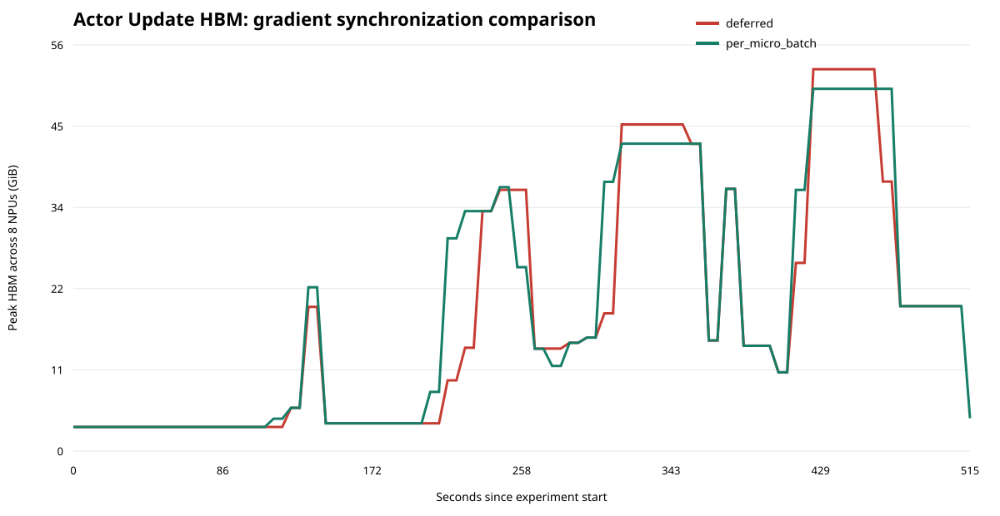
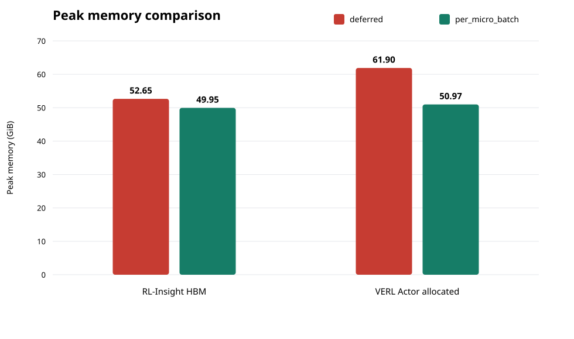

# RL-Insight Actor Update 显存案例

## 实验定义

- 基线 `deferred`：人为注入延迟梯度同步，仅用于复现官方案例的故障机制，不代表当前镜像的原生缺陷。
- 优化 `per_micro_batch`：当前固定镜像的原生行为，每个 micro-batch 正常同步梯度。
- 监控：RL-Insight 0.3.0 管理 Prometheus，采集 8 张 Ascend 910B3 的 NPU Exporter HBM 指标。
- 对照：同一模型、数据、随机种子和 GRPO 参数，仅改变梯度同步模式。

## 结果

| 模式 | 退出码 | RL-Insight 单卡峰值 HBM | VERL Actor 分配峰值 | Actor Update 平均耗时 | Step 平均耗时 | 平均吞吐 |
|---|---:|---:|---:|---:|---:|---:|
| deferred | 0 | 52.65 GiB | 61.90 GiB | 54.09 s | 122.13 s | 225.78 |
| per_micro_batch | 0 | 49.95 GiB | 50.97 GiB | 57.84 s | 126.64 s | 218.19 |

RL-Insight HBM 峰值差值：**2.70 GiB**。VERL Actor 分配峰值下降：**10.93 GiB（17.7%）**。

RL-Insight 的 NPU Exporter 当前按 10 秒采样，可能错过短时 backward 尖峰；因此整机 HBM 曲线用于观察趋势，VERL 的 `perf/max_memory_allocated_gb` 用于确认 Actor Update 瞬时峰值。

## 结论边界

本案例验证“延迟同步保留未分片梯度，会抬高 Actor backward 显存峰值”的机制。当前 VERL 0.7.0 镜像默认没有该开关，因此优化组是现状，基线组是可回退的受控故障注入。模型规模、FSDP 版本和 NPU 数量不同，不能期待复刻官方 64GB 到 36GB 的绝对数值，只比较同环境下的相对变化。
